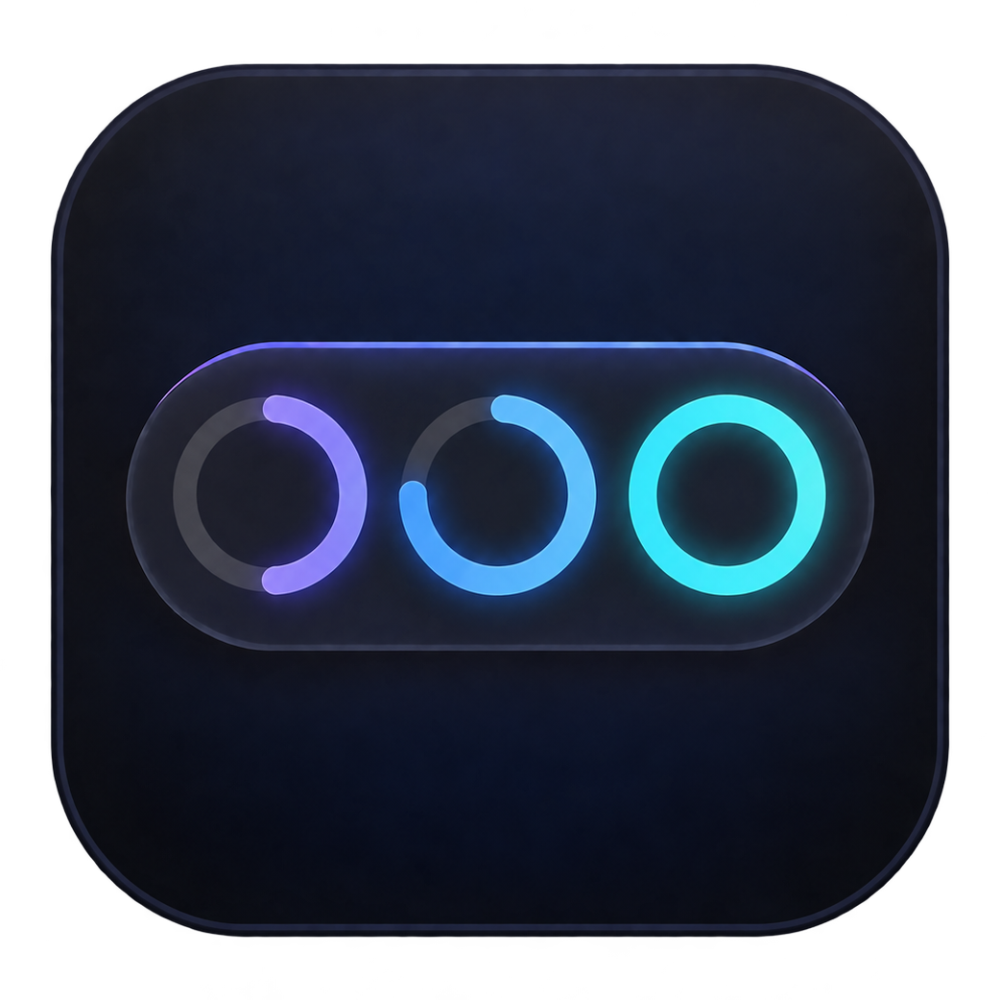

<p align="center">
  
</p>

<p align="center">
  <picture>
    <source media="(prefers-color-scheme: dark)" srcset="docs/assets/workbar-title-en-dark.svg" />
    <source media="(prefers-color-scheme: light)" srcset="docs/assets/workbar-title-en-light.svg" />
    
  </picture>
</p>

<p align="center">
  A lightweight, AI-native desktop task tool that keeps your progress in view.
</p>

<p align="center">
  <a href="README.md">简体中文</a> · English
</p>

## Demo

https://github.com/user-attachments/assets/036322a3-6476-49cb-87ed-9affe69616ee

## Features

- **Count-up timers**: Track the time you spend on each task without setting a duration in advance.
- **Countdown timers**: Set an estimated duration and see the time remaining or when a task runs over.
- **English and Chinese interfaces**: Follow your system language by default, or switch from the tray menu. Changes apply immediately and your choice is remembered.
- **Let AI manage your tasks through MCP**: Once connected, your AI client can create, view, edit, reorder, and delete tasks, as well as start, pause, resume, or complete them. Manage your WorkBar tasks and timers through conversation.

## Quick Start

Windows x64 · **About 2 MB to download · About 6.4 MB installed (including MCP)**

**[Download for Windows](https://github.com/Obsucre777/WorkBar/releases/latest/download/WorkBar-setup-win64.exe)**

The app supports English and Simplified Chinese. Chinese system languages use Simplified Chinese by default; other system languages use English. You can override this from the tray menu under **Language**.

1. **Install and launch**: Run the installer, then open WorkBar. The installer automatically adds `workbar-mcp` to your user PATH.
2. **Connect via MCP**: Send the following prompt to your AI client and let it set up the connection. Once setup is complete, start a new conversation to use WorkBar.

   ```text
   Please connect the WorkBar installation on this computer to this AI client's MCP setup.

   WorkBar connection details:

   - Server name: `workbar`
   - Transport: `stdio`
   - Command: `workbar-mcp` (added to PATH during installation)
   - No command-line arguments, API key, or remote URL required

   First check that the command is available, then confirm how this client supports MCP connections.
   Complete the configuration directly wherever possible.
   Prefer user-level configuration and preserve any existing MCP servers.
   If WorkBar is already connected, check the existing configuration instead of adding a duplicate.

   After configuration, verify that the connection and tools work using read-only queries;
   do not change my tasks during verification.
   If authorization, a client restart, or a new session is required, clearly explain the next step.
   If automatic setup is not possible, provide the fewest manual steps needed.
   ```

3. **Set up global instructions**: Send the following prompt to your AI client and ask it to save these rules in its global instructions or rules.

   ```text
   Please save the following WorkBar task-tracking rules in this client's global instructions
   or global rules, preserving all existing rules.

   # WorkBar Task Tracking

   - Record only actionable work worth tracking and to-dos explicitly requested by the user.
     Do not create separate records for casual conversation, clarification, simple questions
     or lookups, progress inquiries, or steps within a task. When uncertain, do not record.
   - Before starting work, call `workbar_start_work` with a title summarizing the task's goal
     in the user's language. If the user only asks to add a to-do, use `workbar_add_tasks`
     and do not start the work on your own.
   - Reuse the same record across turns for the same task. Do not finish it while waiting
     for the user. When the task is complete, has failed, cannot continue, or is canceled,
     call `workbar_finish_work`, accurately describe the outcome, then give your final response.
   - If a tool's parameter definitions are missing, load them first. If WorkBar is disconnected
     or a tool call fails, skip tracking silently and continue the work. Do not substitute
     other tools or files, and do not retry repeatedly in the same conversation.
   - Do not mention tracking or timers in your replies unless the user asks.
     Stop tracking if the user asks you to disable it.
   ```

4. **Add your first task**: Tell your AI client: “Add writing the project documentation to WorkBar, with an estimate of 30 minutes.” The task will appear at the top of your desktop.

## Common Actions

| Action | How |
| --- | --- |
| Pause / resume a timer | Click the task's timer ring. |
| Complete a task | Click the ✓ button beside the task. |
| Browse more tasks | Click the left or right arrow. |
| Collapse / expand | Press `Alt+W` (the default shortcut), or click the tray icon. When collapsed, click the thin line at the top of the screen to expand. |
| Change the shortcut | Right-click the tray icon → “Set shortcut…”. |
| Change the language | Right-click the tray icon → “Language” → “Follow system”, “简体中文”, or “English”. |
| Launch at startup | Right-click the tray icon → “Launch at startup”. |
| Quit | Right-click the tray icon → “Quit WorkBar”. |

## Feedback and License

Found a problem or have a suggestion? Open an [issue](https://github.com/Obsucre777/WorkBar/issues).

This project is open source under the [MIT License](LICENSE).

## Community

[LINUX DO](https://linux.do/) · A community for new ideals

## Star History

<a href="https://www.star-history.com/?repos=Obsucre777%2FWorkBar&amp;type=date">
  <picture>
    <source media="(prefers-color-scheme: dark)" srcset="https://api.star-history.com/chart?repos=Obsucre777/WorkBar&amp;type=date&amp;theme=dark" />
    <source media="(prefers-color-scheme: light)" srcset="https://api.star-history.com/chart?repos=Obsucre777/WorkBar&amp;type=date" />
    
  </picture>
</a>
