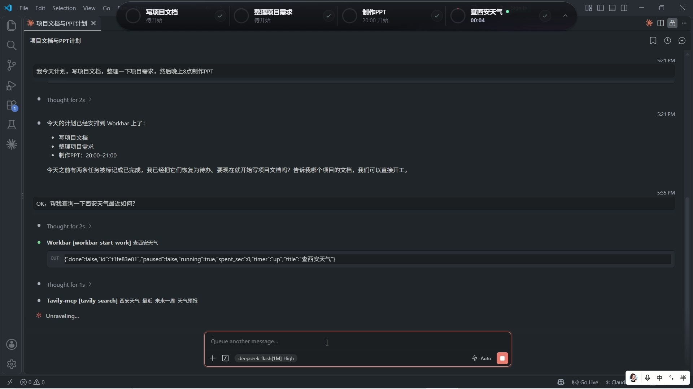

  

<h1 align="center">WorkBar</h1>

<h3 align="center">简洁小巧，专注当下。</h3>

  一款 AI 原生的轻量桌面任务工具，让任务进展尽在掌握。

## 让你和 AI 正在做的事，始终可见

一句话安排今天的计划，把工作交给 AI，任务与计时同步呈现在桌面顶部。

[▶ 观看完整演示（45 秒）](<WorkBar的github演示视频.mp4>)
